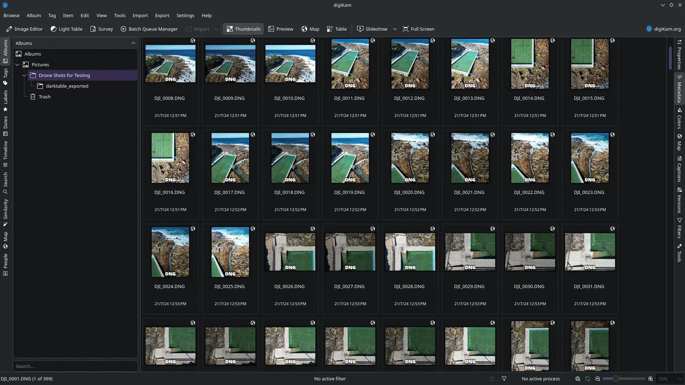
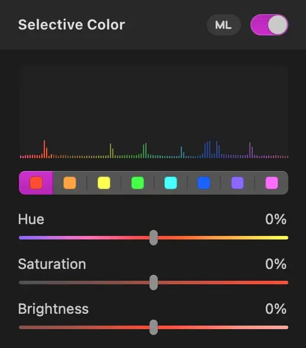
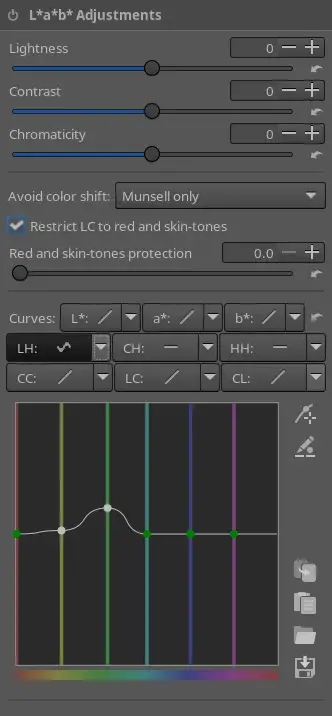

digiKam with some of my drone photos.
{:class="caption"}

My typical photo editing process is the [MacOS Photos app](/2022/03/20/the-good-and-bad-of-photos-for-macos/) for managing the library, then [Photomator](/2023/05/24/photomator-for-macos/) for editing, or Pixelmator Pro for more involved edits. If I'm on my phone, [I'll use Photomator for iOS](/2024/12/02/appreciating-the-fine-art-of-phone-photography/).

When I [tested out NixOS](/2026/10/11/inevitably-nixos/) I installed it onto my specifically-for-Linux-testing ThinkPad, which I've been using to try out some Linux photo editors.

# digiKam

DigiKam seems to mostly be a photo library management system with basic editing capabilities. For managing a photo library it seems perfectly competent. You can tag or label photos, and navigating between photos is fast, which I find essential for identifying which version of a shot I want to keep and edit. It easily imported photos from an SD card just fine, copying them into the Pictures directory and adding them to a new album.

I haven't used the library interface heavily—I'm sure I would have more to say if I imported thousands of photos across many albums—but my initial complaints would be at the small size of the thumbnails, with so much space taken up by mostly irrelevant information. The same amount of space is reserved for the filename and time as is given for the actual image. Thankfully this can be configured, so I've _just_ disabled all the info that would sit under the image.

The digiKam editor does not work with the way I edit photos. Each action that you can perform on the image is a separate tool that you must enter into, adjust, and exit from. This separation makes it difficult to do "exploratory" editing where you tweak and adjust different settings to see how they interact in the final image.

This is particularly annoying with the rotate and crop tools. I am used to doing both at the same time, and I'll balance how much I rotate with how it impacts my ability to get my desired crop—or vice versa. Since these are two separate tools in digiKam, I would first need to rotate a certain amount, and then crop in based on that rotation. If I couldn't get the crop I wanted, I'd have to go back to the rotate tool and adjust before restarting the crop to see if it worked better.

What I think is happening is that each tool builds a new image. The rotate tool returns an image with a rotation applied, the crop tool returns an image that is cropped. This means that if I adjust the exposure, use some other tool, and then want to readjust exposure, I'm applying a _new_ adjustment on the already-adjusted image. If I adjust the exposure to be too bright, and then try to adjust it back down again, I will have lost data in any area that clipped to 100% brightness with the first adjustment (or in the inverse scenario, that clipped to 0% brightness).

If you already know exactly what adjustments you want to make, especially if it's just one or two adjustments, this model might work for you. However, since I edit quite heavily, and will tweak things back and forth to get it just how I want, this doesn't work for me.

# RawTherapee

Editing an image in RawTherapee works closer to the way I want it. You can move between different adjustments easily. I did get caught out by the fact that adjustment controls look like they're active, but the section might be deactivated by default, so the controls won't do anything.

It's also weird that panning the image with the mouse doesn't move it 1:1. Dragging with the mouse makes the image move faster than the mouse is moving. This isn't much of a problem (it still moves slow enough that you can easily position it) but it's weird to break out of a standard "direct interaction" model.

My overall impression with RawTherapee is that there are too many visible knobs in the editing UI. I would prefer a more progressive disclosure of control/complexity. For example, I often like to tweak the hue, saturation, and brightness of a specific colour range. In Pixelmator the interface looks like this:

In RawTherapee the interface looks like this:

Obviously most of the problem here is that I don't know what most of this interface means. I don't know how the top-level L\*a\*b\* adjustments differ from the standard exposure controls, and having six different drop-downs that reveal the hue adjustment controller is a _lot_.

I assume that I can customise this, but it seems weird that the default set of tools includes niche or advanced tools right next to basic ones. Right under white balance is "gamut compression". White balance is something almost everyone will use to make their image look more natural if it wasn't captured with quite the right settings, and [gamut compression is](https://rawtherapee.com/downloads/5.12/):

> A new tool called Gamut Compression applies the ACES (Academy Color Encoding System) Reference Gamut Compression operator to improve the look of highly-saturated colors and bring colors within a selectable gamut before applying other color-related tools offered by RawTherapee.

It is awesome that these tools are available, but I think it would be even better by default the tools you saw were the most relevant ones.

# darktable

I've played with Darktable a little before, so I went into this expecting to be frustrated again, but I was mildly surprised.

Darktable's interface is similar to RawTherapee. There are a lot of tools with a lot of options, and as a second-time user they don't feel incredibly relevant. I did find a menu that changed the layout to "workflow: beginner" that got rid of some stuff, but the tool selection and order still didn't feel coherent.

The controls are set in a scrolling list, but if you scroll while the cursor is over a control, you will adjust the control. This turns the adjustments panel into a hazard. I'll mouse over to the panel, habitually start to scroll, and then have made some random adjustment to my photo. I ended up carefully grabbing the scrollbar, which was tedious since I'm used to using trackpad gestures to quickly scroll.

I've just found that there's a setting to turn this behaviour off (settings, miscellaneous, "mouse wheel scrolls module side panel by default") but it seems like an error-prone default to me. Perhaps Darktable users use big monitors and curated tool sets, so they have less need for scrolling and the quick input is more valuable.

Controls in Darktable also have more range than I find useful, which gives less space for the range that I will actually use. For example the exposure control goes from -4EV to +4EV, but I think the useful range is much closer to -2EV to +2EV. If the control had this smaller range, it would be easier to precisely select a particular value. The selective colour adjustment ("color equalizer") is similar—I rarely want to shift a colour more than say 20 degrees, but the UI shows a full 360 degree range, so a typical adjustment is a very precise, fine movement.

Pixelmator works around this really nicely. Every control has—what I think is—a reasonable upper and lower bound, but if you hold the option key, all the limits double and you can push a slider further than it would go by default. Most of the time you get the more precise control, and the higher limit is a single button push away. I think there's even a setting to use the higher limits all the time.

I did pop into the settings to change the UI theme in Darktable to be darker (somewhat closer to 25% grey instead of the default that is closer to 50% grey). This doesn't change the background behind the image that your editing, which is annoying. You can tweak that with custom CSS, but it would be convenient if that was a simple toggle.

More generally, I found Darktable's custom UI to have insufficient differentiation between sections. Almost everything is similarly-sized text above sliders, so it's hard to create a clear hierarchy. Using something closer to the system controls (like RawTherapee does) would help here, as the current style doesn't differentiate enough between a header, a text field, and a dropdown. Borders around controls, colours on active controls, and a few more shades to differentiate control types would go a long way.

A common theme while looking up how to make a particular adjustment in Darktable was people giving advice to avoid a particular module (a component in the UI) as it had some problem or wasn't as accurate as a replacement module. This is obviously just part of using a mature system, but it does create a concern that I might be using the "wrong" set of modules. Keeping the old modules for compatibility is great, but marking them as obsolete would be more friendly to a new user.

The most annoying missing feature—or difference in behaviour—between Darktable and what I'm used to is the ability to quickly toggle between the edited and unedited versions of the photo. In Pixelmator you just hold control-m and the preview swaps between the two. Darktable has what is on paper a much more capable system, where you can record snapshots of edits and compare between them, but to me this just seems like unnecessary complexity for a simple feature.
# Verdict

It's hard to judge these against my usual workflow since I'm testing on a much older and less powerful machine than what I use for photo editing normally. Almost no adjustment works in real time on this laptop, so it's not a fair comparison to see how effective they are for quickly editing a large batch of photos. The Intel i5-8265U in my ThinkPad has about half the single-threaded CPU performance of the M4 in my MacBook Air.

I've also got about 7 years of muscle memory with Pixelmator and Photomator, and to make things even easier they share most of their UI.

The default interface and behaviours really matter. With the standard interfaces I was ignoring most of the controls and spending a long time hunting around for the most basic tools. Progressive disclosure of complexity would help a lot, as well as having an expected workflow that informs the layout of the tools.

Pixelmator and Photomator split tools into crop/rotate, adjustments, and effects, which gives a little more space for each to have their own custom UI, rather than having a single drawer of tools. This informs my workflow, as I will usually edit the exposure and colours of an image, and then crop to my desired framing as a separate step.

Obviously a huge part of this is the fact that I've got seven years of habits and muscle memory with Pixelmator and Photomator, and I've only spent a few hours tinkering with these three applications. So obviously keep that in mind, as I'm sure someone going in the opposite direction would have their own confusions.
