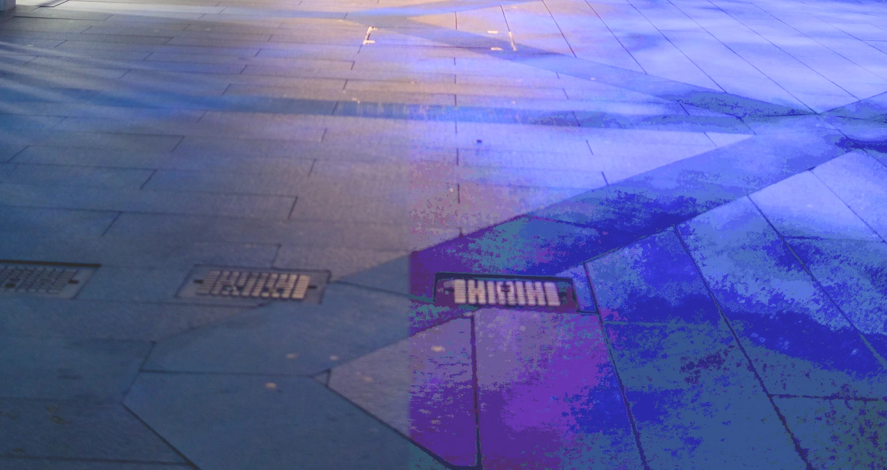
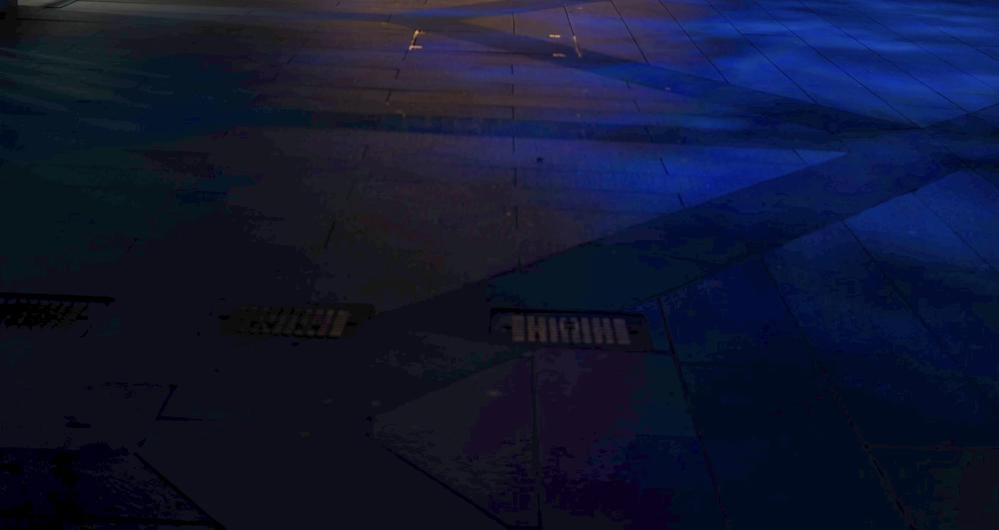
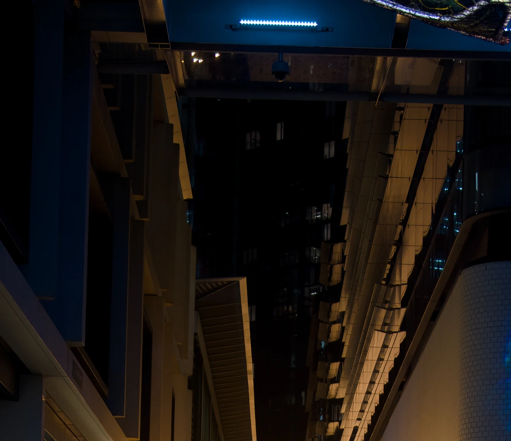
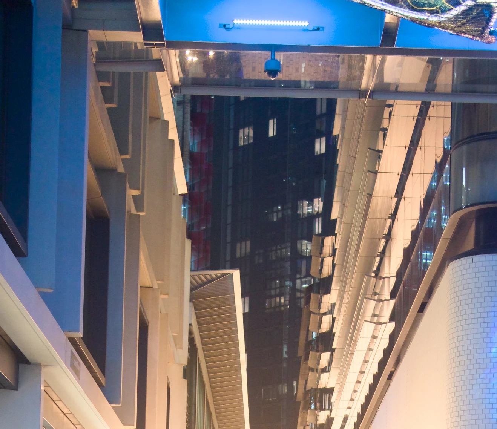
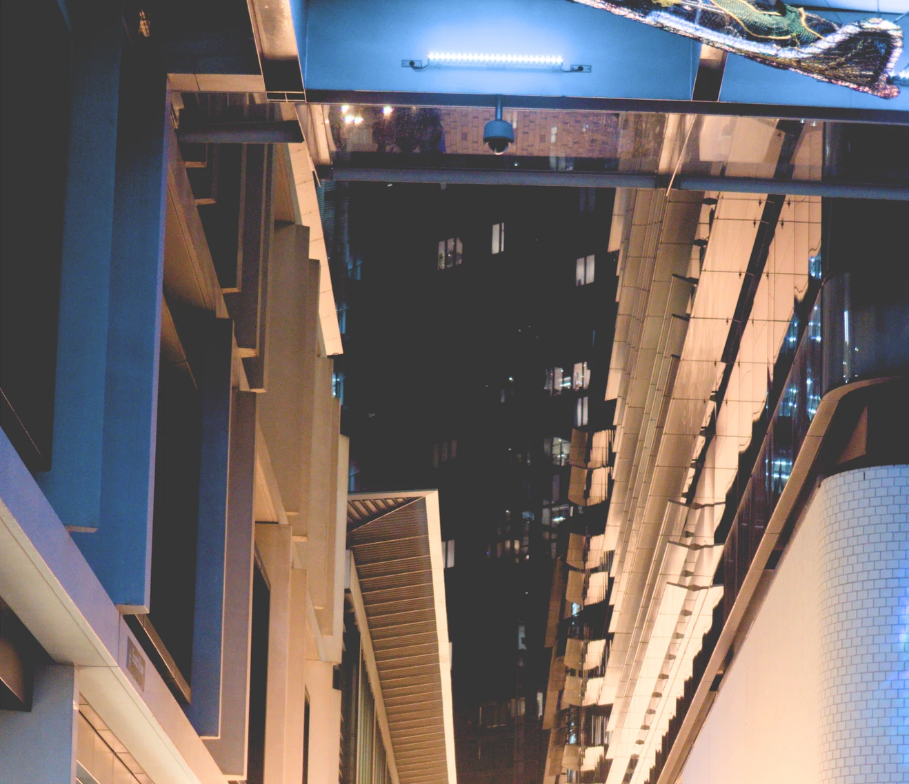

Did you know that the "raw" in "[raw photo](https://en.wikipedia.org/wiki/Raw_image_format)" isn't an acronym? It's just "raw" as in "unprocessed". So when someone writes it as "RAW", they are being incorrect?

I've been looking at the best way to archive old raw photos in my photo library, in an attempt to [dig myself out of the pit of despair that is photo library management](/2025/12/26/stuck-in-a-photo-management-factory/).

My Sony a6500 (and the a6000 before it) save images as Sony ARW files. From the 24MP sensor, these images are usually around 24MB. As I'll explain later, shooting with these larger files (instead of having the camera just save JPEGs) is worth it, but for long-term storage of images I took years ago, maybe the storage isn't worth it.

The best case scenario here is that I can export the ARW files from my photo library to a format that cuts 20–30% of the file size, but still gives me enough data to go back and edit them. Ideally if I edit one of these photos, I'm not prevented from making adjustments due to a lack of data. ARW files from my a6500 have an astonishing amount of detail in the shadows and highlights that can be recovered later, and it would be a shame to throw that away.

# Zip It

Chucking one of my ARW files into a Zip file shrunk it from 24.9MB to 22.9MB, which was more than I expected. A 9% reduction isn't too bad for zero loss in quality.

# JPEG

The obvious answer is to just export as JPEG. They're smaller, compatible with everything, and can be exported from any software. I exported two test images from Apple Photos at full size and maximum quality. The resulting files were 13.3MB and 5.8MB, a 47% and 77% saving, which is amazing.

To compare how well they'd respond to edits I opened both versions in Pixelmator Pro and applied the same exposure adjustment to see what the shadows looked like. I'm cranking the exposure _way_ up to try and spot the details present in the ARW that would probably be thrown away in the process of converting to JPEG. It's not an adjustment you'd normally make unless you'd messed up your exposure when you took the photo.


ARW on the left, JPEG on the right.
{:class="caption"}

That looks bad. I did intentionally find a photo with both bright highlights and dark shadows to test with, since that should represent close to the worst case that I'm worried about.

# HEIC

This is the more efficient format that iPhones have been using for ages, so presumably Apple Photos would be good at exporting them. I exported the same image, opened it in Pixelmator Pro, and was presented with this:


HEIC image with no exposure adjustments.
{:class="caption"}

The HEIC was only 635KB, compared to the 24.9MB of the ARW. That's a hefty 93% saving, but that's not just at the expense of shadow detail that you can't see. This banding is present before any adjustments, and is obvious even without looking at the original.

Looking at the second test shot, it's nowhere near as bad, but this has shattered my confidence in HEIC to actually store an image worth looking at.

# DNGLab

I wanted to see what results I could get from compressed raw formats. Apparently compressed [DNG files](https://en.wikipedia.org/wiki/Digital_Negative) can get good results. I installed [DNGLab](https://github.com/dnglab/dnglab) which is a CLI to archive images (including Sony ARWs) as DNGs, offering both lossless and lossy compression.

I used these two commands to compress my test images:

```console
$  dnglab convert -c lossy --embed-raw false . dnglab/
$  dnglab convert -c lossless --embed-raw false . dnglab/
```

The lossless files were slightly bigger than the ARWs they replaced, so that's a bit of a dead end. The lossy images were about 75% less than the original, but both had a significant purple tint. I assume this is a bug in DNGLab's raw processing, so it seems like it's not yet ready for this kind of use.

# Adobe DNG Converter

Honestly, I wish I didn't have to do this. Truly. I built DNGLab from source in the hope that I wouldn't have to go through this, but here we are. I downloaded all 1.8GB from Adobe's website, ran the installer package, which installed all of the 2.7GB application onto my computer.

Just think how many images I could store in the space used by this application, whose one job is to convert between one file format and another file format. Why is this image converter larger than many Linux distribution installer ISOs? No one knows.

Anyway, I converted my test images to both lossless and lossy DNGs. Like with DNGLab, the lossless images were slightly bigger than the original files, and the lossy images were about 80% smaller than the originals.

So to compare the quality of the shadows I was looking at this part of the image:


ARW with no exposure adjustments.
{:class="caption"}

The shadows are almost entirely black—because the camera was exposing for bright lights in the foreground. With the power of ARW, I can crank up the exposure and see what was actually there:


ARW with the exposure turned up to show the shadow detail.
{:class="caption"}

This is why if you're wanting to get the most out of your camera, you should be shooting raw. The amount of extra flexibility you get to retroactively fix mistakes is incredible. Just imagine if I was working with a JPEG here, it would be a mess of colour banded nonsense.

Anyway what's interesting about the DNG is that it doesn't recover the darkest shadows, but the areas where this is detail get brightened without terrible banding.


DNG with the same exposure adjustment, showing missing shadow detail.
{:class="caption"}

What's interesting is that the lossless image had the same behaviour, neither DNG would recover the shadows like the ARW did.

---

The clear winner for me is the lossy DNG, with the huge caveat that I hate having Adobe's DNG converter installed. It feels like a crime against computing. It's hard to beat the file size savings of the DNG paired with how well it responded to exposure changes. I wouldn't be able to get the full detail, but it seems like I'm not going to run into banding or discolouration with DNG.

A notable exclusion here is JPEG-XL, which should be able to get smaller file sizes than regular JPEG. I'm not sure if you get more flexibility while editing. I couldn't find a convenient way of converting ARW to JPEG-XL, but it's something I want to look into some more.

My next step will probably be exporting and converting a _lot_ of photos to DNG, seeing what the aggregate storage savings are, and seeing how it handles different types of images.
