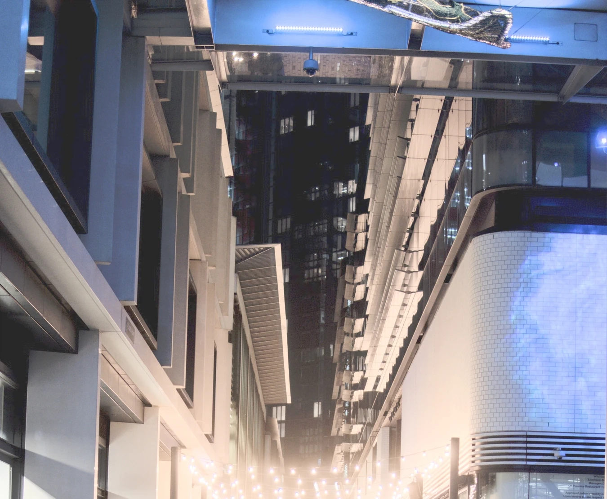
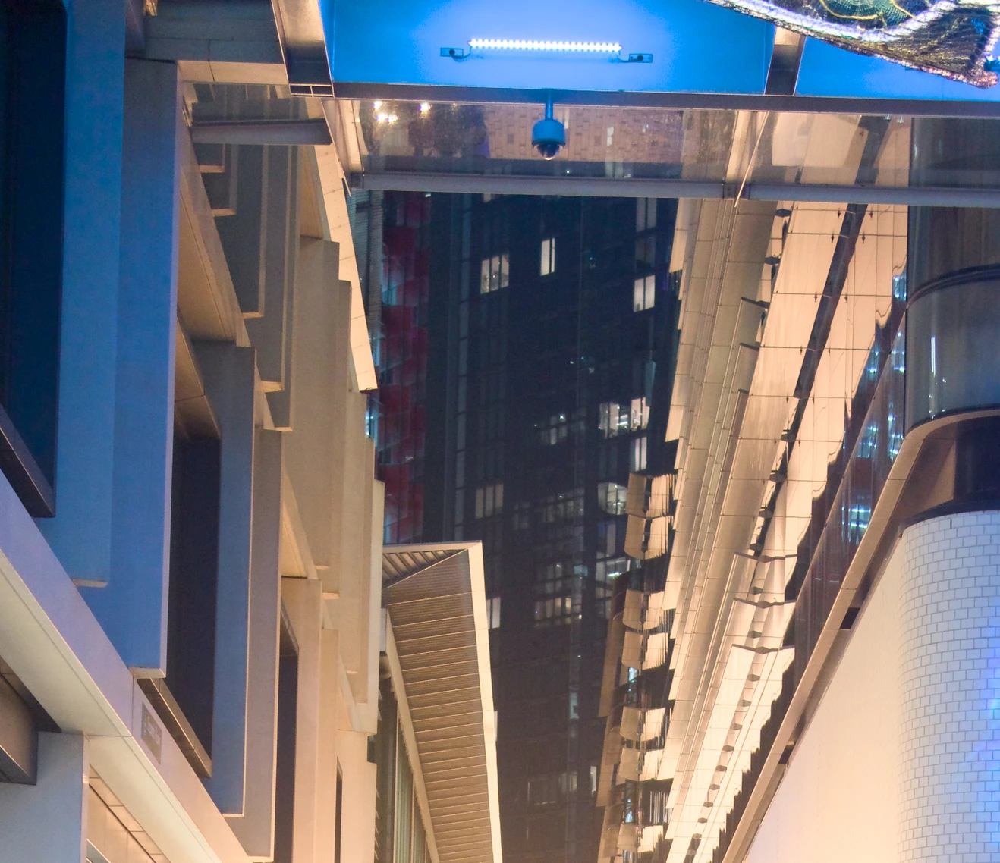

After I wrote [my last post](/2026/11/08/image-formats-for-photo-archiving/) comparing the quality and size of different image formats to replace Sony ARW files, a friend asked "why didn't you compare JPEG-XL?"

The reason I didn't include it was because I didn't think I had a good way of batch converting raw photos to JXL. This made it too esoteric and not a practical option for my archival purposes. However, I then realised that I could have just used [Darktable](https://www.darktable.org/) to convert ARW to JXL.

I exported my test images to JXL, then opened them up in Pixelmator Pro to compare against the original ARW files.

The shadow reconstruction is most similar to the DNG file. You don't get all the detail in the darkest area, but the slightly lighter areas retain more detail and have no colour banding, allowing them to be recovered more easily. Like the DNG they adjust to a natural shade.

JPEG-XL image with exposure boosted to see how much detail we've kept in the shadows.
{:class="caption"}

For comparison, here's the exposure-boosted ARW file.

ARW with the exposure turned up to show the shadow detail.
{:class="caption"}

There are some very minor artifacts in the JXL that aren't present in the DNG file, mostly where a dark area transitions to a slightly lighter area. It's hard to say whether this is bad enough to spend an extra 50% on storage and having to use the Adobe DNG Converter.

Pixelmator Pro, Photomator, and the MacOS Photos app all use Apple's image libraries to load and edit images, so images loaded into any of them look identical. Darktable has its own image libraries, and so it processes the images slightly differently. You can see this difference in brightness and colour in the two images above.

I tried to disable some of the helpful automatic adjustments (like increasing the exposure if the image was captured with a negative exposure value) but JXL export is still a little different than the other formats I've been comparing. This is not a problem with Darktable, it's just a difference that I'm not really accounting for. I'm sure someone more familiar with it could make the default adjustments more closely match those of Apple's libraries.

Interestingly I did export as plain JPEG from Darktable as well, and didn't see any of the colour banding that I saw with the Photos app exporter. The JPEGs were still about twice the size of a JXL, so there's not much point in using them, but it seems like the colour banding isn't a problem intrinsic to the format.

I was a little surprised at the encoding time difference between different quality levels with JPEG-XL. Effort is a scale from 1 to 9, and initially I tested level 8 because I wanted these files _small_. It took on average 26 seconds per image on my M4 MacBook Air, and 33 seconds on my home server (an Intel i5-1135G7). It's surprising to me that the M4 is so close to the i5. The CPU usage didn't seem to spike much, so I'm not sure where the time is being spent. I didn't look into this much further than that.

Thankfully at lower effort levels, the encoding speeds up dramatically. At level 7 (the default) it's 5 seconds each, and at level 6 it's 2 seconds each on the M4.  The size difference between effort level 6 and 9 on my test image was only 100kB, so if I use this for archiving the lower effort level will save me a lot of time while not using that much more storage space. Remember that the original image is 24.9MB, and we're going down to 2.6MB. Going to 2.5MB for 16 times the encoding time just isn't worth it.

JXL seems to be a clear winner in terms of size and general image quality. I haven't committed to encoding my entire image archive just yet.
